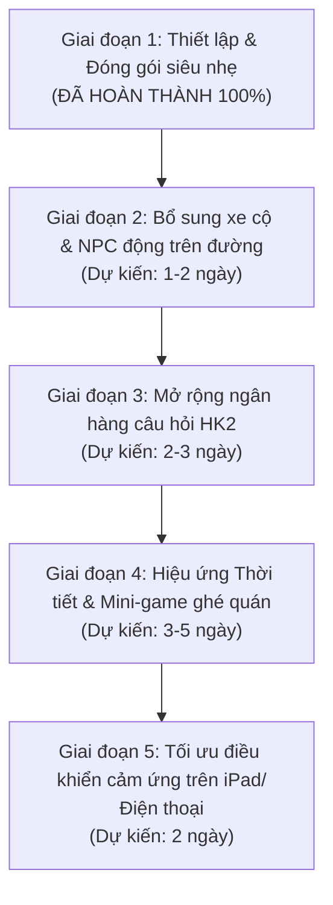

# 📋 KẾ HOẠCH TRIỂN KHAI & LỊCH TRÌNH CHỈNH SỬA (IMPLEMENTATION PLAN)
### Dự án: Chip English Adventure & 3D Anime City Commute
> **Mục đích tài liệu:** Đem sang máy tính khác hoặc mở project mới để "vibe code" tiếp tục một cách nhanh chóng nhất (trong vòng 1 phút), không cần cấu hình lại môi trường từ đầu.

---

## ⚡ 1. Khởi tạo Project trên máy mới trong 3 bước (Quick Scaffolding)

Khi bạn copy thư mục này (hoặc giải nén `dist/chip_english_adventure_lightweight.zip`) sang máy tính mới:

1. **Bước 1: Mở thư mục dự án trong VSCode / Cursor / Windsurf**
   ```bash
   cd "thư-mục-chứa-code"
   ```
2. **Bước 2: Khởi động server nội bộ (1-Click)**
   - Nhấp đúp chuột vào file `start_tool.bat`
   - Hoặc gõ lệnh: `python start_tool.py --run`
   - *Kết quả:* Trình duyệt sẽ tự động mở `http://localhost:8000/index.html`. Không bị chặn CORS, không dính cache khi sửa code.
3. **Bước 3: Bắt đầu Vibe Code**
   - Mở cửa sổ chat với AI, copy đoạn **Prompt mẫu ở Mục 5** dán vào là AI nắm toàn bộ ngữ cảnh dự án ngay lập tức!

---

## 🗺️ 2. Bản đồ tệp mã nguồn - Sửa cái gì thì vào đâu?

| Mục tiêu chỉnh sửa | File cần mở | Dòng / Hàm quan trọng |
| :--- | :--- | :--- |
| **Thêm / đổi câu hỏi SGK Lớp 5** | `data.js` | Mảng `const GRADE_5_ISLANDS` |
| **Thêm cửa hàng, biển hiệu anime 3D** | `city_commute.js` | Hàm `_buildDetailedSignboard(shop)` & `_buildBilingualCity()` |
| **Chỉnh xe máy Honda Vision hai ba con** | `city_commute.js` | Hàm `_buildHondaVision()` & `_animateBikeAndRiders()` |
| **Thêm xe cộ chạy trên đường (Vios, Wave...)** | `city_commute.js` | Hàm `_spawnTrafficCar()` |
| **Đổi góc nhìn Camera (Lái xe / Ngắm cảnh)** | `city_commute.js` | Biến `cameraMode`, `cameraYawOffset`, `cameraDistOffset` |
| **Chỉnh sân trường Ngô Quyền & Đấu trường 3D** | `three_arena.js` | Lớp `ThreeArena`, bục thi đấu `_createIslands()` |
| **Chỉnh logic tính điểm, Streak, Avatar phát biểu** | `game.js` | Lớp `EnglishGameEngine`, hàm `speakBilingual()` |
| **Chỉnh giao diện nút bấm, HUD, thanh máu/sao** | `index.html` + `style.css` | Thẻ `#commute-hud`, `#quiz-modal`, `#avatar-box` |
| **Tạo giọng đọc AI mới tự động** | `tools/generate_audio_edge.py` | Chạy `python tools/generate_audio_edge.py` |

---

## 📅 3. Lịch trình chỉnh sửa & Các mốc phát triển tiếp theo (Vibe Roadmap)

Dưới đây là lịch trình các giai đoạn đề xuất để bạn tiếp tục phát triển dự án:



### 📍 Giai đoạn 1: Môi trường di động & Đóng gói siêu nhẹ (✅ ĐÃ XONG)
- [x] Tạo `start_tool.bat` tự tìm Python, tự xử lý CORS, tự tìm cổng trống.
- [x] Tạo `tools/generate_audio_edge.py` sinh giọng AI Neural miễn phí không cần GPU.
- [x] Đóng gói siêu nhẹ ~39MB loại bỏ file nặng, sẵn sàng chuyển máy.

### 📍 Giai đoạn 2: Tăng độ sống động cho đường phố (Vibe Code tiếp theo)
- **Mục tiêu:** Cho xe cộ trên đường chạy thật thay vì đứng yên làm vật cản.
- **Cách thực hiện:**
  1. Trong `city_commute.js`, tìm mảng lưu các xe cộ `this.trafficVehicles = []`.
  2. Trong hàm `update(delta)`: Cho tọa độ $Z$ của xe ngược chiều di chuyển: `car.position.z += car.speed * delta`.
  3. Khi xe chạy vượt quá tầm nhìn ($> 150m$), tái đặt vị trí xe ở phía trước đường để tạo luồng giao thông vô tận.

### 📍 Giai đoạn 3: Bổ sung Ngân hàng câu hỏi SGK Unit 11 -> Unit 20
- **Mục tiêu:** Hoàn thiện toàn bộ chương trình Tiếng Anh Lớp 5 cho bé Hà My.
- **Cách thực hiện:**
  1. Mở `data.js`, thêm các object câu hỏi theo format:
     ```javascript
     {
       id: "g5_u11_q01",
       question: "What's the matter with you? - I have a ______.",
       options: ["headache", "toothache", "stomach ache", "sore throat"],
       answer: 0,
       teacherIntro: "Hà My ơi, bạn nhỏ trong hình đang bị đau đầu kìa!",
       teacherPraise: "Chính xác xuất sắc Hà My ơi! Headache là đau đầu!",
       teacherCorrection: "Chưa đúng rồi con yêu, headache mới là đau đầu nhé!"
     }
     ```
  2. Bấm `start_tool.bat` ➔ chọn **[2]** để AI tự động sinh file âm thanh cho các câu mới.

### 📍 Giai đoạn 4: Mini-game Tương tác trên đường phố
- **Mục tiêu:** Khi xe chạy qua các quán nổi tiếng, người chơi có thể bấm ghé vào:
  - **Quán Phở Lý ($Z \approx 60$):** Ăn phở trả lời từ vựng về món ăn ➔ Hồi 100% năng lượng.
  - **Tiệm Elise Ngô Quyền ($Z \approx -285$):** Thử đồ đổi trang phục cho bé Hà My.
  - **Sân Vườn Bonsai Vũ Dậu ($Z \approx -1190$):** Về đến nhà, ngồi uống trà đá ngắm cá Koi và tổng kết điểm sao tím.

---

## 🎯 4. Hệ tọa độ 3D & Công thức thêm vật thể vào phố

Tuyến đường dài **1.19 km** (từ Trường Tiểu Học Ngô Quyền về Sân Vườn Vũ Dậu) được đánh số 41 Waypoint:

```
[Waypoint 0: Cổng Đình / Nhà Hà My] (Z ≈ +65)
          ↓ (Phố Trần Quốc Tuấn)
[Waypoint 1: Quán Phở Lý & Rèm Cửa] (Z ≈ +40)
          ↓
[Waypoint 6: Số 24 Ngô Quyền - Tiệm Elise & Vàng Bạc] (Z ≈ -285)
          ↓ (Phố Ngô Quyền)
[Waypoint 7: Ngã Ba Lê Xoay - Tiệm Huyền Hậu & Vinamilk] (Z ≈ -500)
          ↓
[Waypoint 12: Bưu Điện Tỉnh & Bùng Binh Kim Ngọc] (Z ≈ -900)
          ↓
[Waypoint 41: Sân Nhà Cây Cảnh Bonsai Vũ Dậu] (Z ≈ -1190)
```

**Quy tắc tọa độ khi thêm vật thể:**
- $X$: Trục ngang lòng đường.
  - $X = 0$: Tim đường.
  - $X = +9.5$ đến $+14.0$: Vỉa hè bên phải (hướng từ trường về nhà).
  - $X = -9.5$ đến $-14.0$: Vỉa hè bên trái.
- $Y$: Độ cao ($Y = 0$ là mặt đường nhựa, $Y = 0.2$ là mặt vỉa hè).
- $Z$: Chiều dài tuyến đường theo mét (giảm dần từ $+65$ xuống $-1190$).

---

## 💬 5. Đoạn Prompt mẫu để "Vibe Code" tiếp với AI trên máy mới

Khi sang máy tính mới và mở AI chat, bạn chỉ cần copy nguyên văn đoạn dưới đây gửi cho AI để AI hiểu ngay cấu trúc dự án:

```markdown
Chào bạn, đây là dự án "Chip English Adventure & 3D City Commute" viết bằng Three.js thuần (Vanilla JS, không dùng Webpack/Node build).
- index.html: Giao diện chính và CSS Anime Studio Ghibli.
- city_commute.js: Lõi 3D thành phố 1.19 km (Phố Trần Quốc Tuấn -> Ngô Quyền -> Lê Xoay -> Bưu Điện VNPT -> Vườn Vũ Dậu) với xe máy Honda Vision hai ba con.
- game.js: Logic câu hỏi SGK Tiếng Anh Lớp 5 cho bé Hà My 5C4 và cơ chế phát âm thanh Fallback 3 tầng.
- data.js: Ngân hàng câu hỏi mảng GRADE_5_ISLANDS.
- start_tool.bat / start_tool.py: Máy chủ nội bộ hỗ trợ CORS, no-cache và tự tìm port.

Hôm nay tôi muốn bạn giúp tôi phát triển tính năng mới:
[GHI YÊU CẦU CỦA BẠN VÀO ĐÂY, VÍ DỤ: Thêm hiệu ứng đèn đường ban đêm bật sáng khi xe chạy qua, hoặc thêm 5 câu hỏi Unit 12...]
Hãy đọc code hiện tại và sửa trực tiếp drop-in replacement giúp tôi nhé!
```

---

## 🛠️ 6. Quy trình kiểm tra & Đóng gói sau khi code xong

Mỗi khi bạn hoàn thành một tính năng mới:
1. **Kiểm tra trực tiếp:** Nhấn `F5` trên trình duyệt `http://localhost:8000/index.html`.
2. **Kiểm tra tự động ngầm (tùy chọn):**
   ```bash
   python capture_tqt_shops.py
   ```
   Script sẽ tự chụp 6 bức ảnh các góc phố lưu vào thư mục `screenshots/`.
3. **Đóng gói bản cập nhật:**
   - Chạy `start_tool.bat` ➔ chọn phím **[3]**.
   - File nén siêu nhẹ mới sẽ sẵn sàng tại `dist/chip_english_adventure_lightweight.zip` để bạn lưu trữ hoặc chia sẻ!
